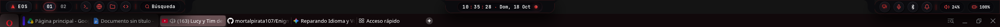
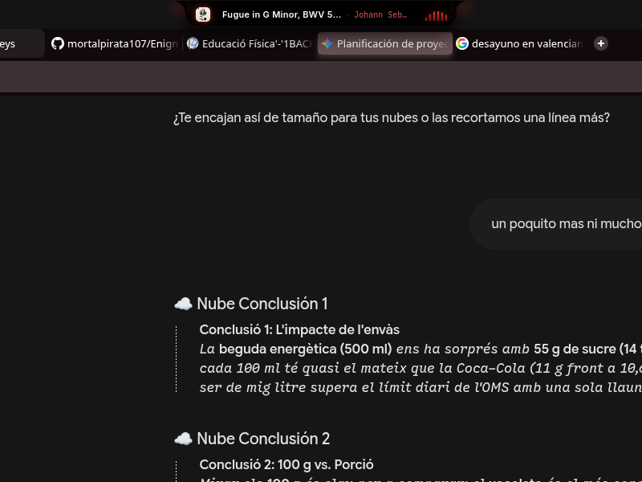
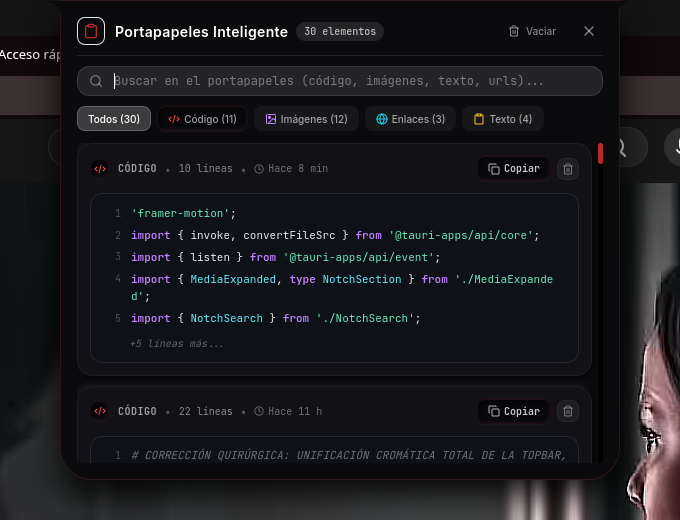
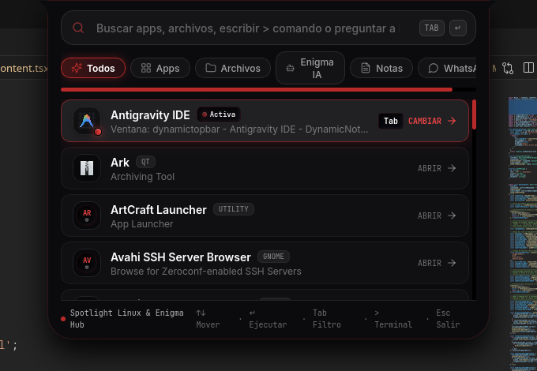
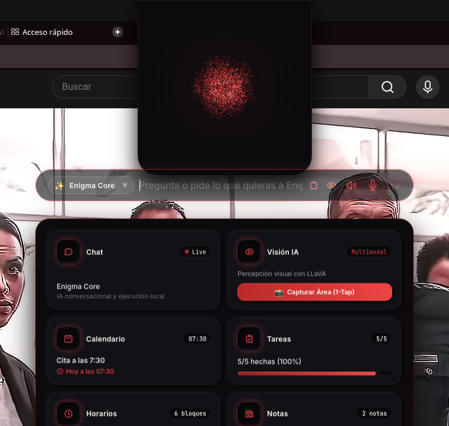

# 🌌 EnigmaOS

<p align="center">
  
</p>

<p align="center">
  <strong>Entorno de sobrecubierta futurista, Dynamic Island, Dock inteligente y Asistente de IA multimodal para Linux (Wayland & X11).</strong>
</p>

<p align="center">
  <a href="https://github.com/mortalpirata107/EnigmaOS/releases"></a>
  
  
  
  
  
</p>

---

## ⚡ Instalación Rápida (1 Solo Comando)

Puedes instalar EnigmaOS en cualquier distribución Linux (Ubuntu, Debian, Arch Linux, Fedora, Manjaro, openSUSE, Pop!_OS) ejecutando en tu terminal:

```bash
curl -fsSL https://raw.githubusercontent.com/mortalpirata107/EnigmaOS/main/install.sh | bash
```

> **¿Qué hace el instalador?**
> - Detecta tu distribución automáticamente.
> - Instala las dependencias del sistema necesarias (`webkit2gtk`, `gtk3`, `cairo`, `alsa`, etc.).
> - Descarga o compila el binario ejecutable y el lanzador optimizado.
> - Registra el acceso directo `enigmaos.desktop` con iconos en tu menú de aplicaciones (KRunner, GNOME Dash, Rofi, etc.).

---

## 📖 Descripción General

**EnigmaOS** es una barra de estado superior flotante modular, dock inferior interactivo y asistente de Inteligencia Artificial multimodal con estética pura neumórfica Cyberpunk. Integra monitoreo del sistema en tiempo real, portapapeles inteligente de alta velocidad, lanzador universal Spotlight y orbe reactivo 3D en WebGL acelerado por GPU.

Diseñado específicamente para entornos modernos de Linux (KDE Plasma 6, GNOME, Hyprland, Sway) con soporte nativo de **Layer Shell (`wlr-layer-shell`)**, permitiendo regiones de entrada dinámicas con clic transparente en áreas vacías y atajos globales con latencia cero a través de `evdev`.

---

## ✨ Características Principales

### 1. 🏝️ Dynamic Notch (Dynamic Island para Linux)
- **Física de resortes ultra-fluida:** Transiciones líquidas orgánicas impulsadas por Framer Motion.
- **Reloj Neumórfico:** Números monoespaciados tabulares con micro-orbe rubí pulsante de latido.
- **Reproductor Multimedia MPRIS:** Detección automática de Spotify y reproductores multimedia con mini-ecualizador espectral animado en carmesí y panel expandido con controles de transporte y barra de progreso.

<p align="center">
  
</p>

---

### 2. 📋 Portapapeles Inteligente con Caché Desacoplado (`Alt + V`)
- **Monitor en tiempo real en segundo plano:** Escucha continua en Wayland con soporte nativo para texto, código, colores, enlaces e imágenes.
- **Clasificador Heurístico Automático:** Identifica y clasifica instantáneamente fragmentos de código (JavaScript, Rust, Python, SQL), colores hexadecimales/RGBA con muestra visual en vivo, URLs con extracción de dominio y texto enriquecido.
- **Arquitectura de Miniaturas + Caché en Disco:** Almacenamiento optimizado de capturas con apertura instantánea en menos de 50 ms.
- **Copiado Nativo en 1 Clic:** Copia directa a nivel de sistema (`arboard` / `wl-copy`).

<p align="center">
  
</p>

---

### 3. 🔍 Lanzador Universal & Spotlight Hub (`Alt + Espacio`)
- **Buscador de aplicaciones y archivos:** Búsqueda difusa ultrarrápida de aplicaciones `.desktop`, binarios del sistema y carpetas.
- **Conversor de divisas y calculadora instantánea:** Resuelve expresiones matemáticas y conversiones de moneda en vivo (ej: `50 usd a eur`).
- **Acciones del sistema:** Atajos rápidos para suspender, bloquear pantalla, reiniciar o apagar.

<p align="center">
  
</p>

---

### 4. 🧠 Enigma AI Hub & VoiceOrb 3D (`Alt + 3`)
- **VoiceOrb 3D en WebGL:** Orbe de partículas carmesí reactivo al audio y estado de inferencia (`idle`, `thinking`, `speaking`, `alert`, `listening`, `searching`).
- **Panel Bento Multimodal:** Chat conversacional (Ollama local / Claude / GPT), Visión IA (captura y análisis de pantalla con modelos de visión), Calendario, Tareas, Horarios y Notas locales persistentes en SQLite.
- **Dictado STT / TTS:** Síntesis y transcripción de voz local con auto-ducking inteligente de audio.

<p align="center">
  
</p>

---

### 5. 🎛️ Cápsulas Modulares de la Topbar
- **Cápsula Izquierda:**
  - Identidad de la distro con menú rápido.
  - Indicador dinámico de escritorios virtuales KWin con cambio reactivo.
  - Lanzadores rápidos de aplicaciones (Terminal, Navegador, Gestor de archivos, Editor).
  - Píldora de búsqueda rápida.
- **Cápsula Derecha:**
  - Wi-Fi y redes cableadas con menú emergente detallado.
  - Micrófono con alternancia de mute en un clic.
  - Bluetooth con listado de dispositivos y emparejamiento.
  - Modo No Molestar (DND).
  - Mezclador de volumen con slider de precisión y estado MUTE.
  - Monitor de nivel de batería con indicador de corriente CA.

---

## ⌨️ Atajos de Teclado Globales

| Atajo | Acción |
| :--- | :--- |
| **`Alt + Espacio`** | Abre / Cierra el Lanzador Universal Spotlight |
| **`Alt + V`** | Abre / Cierra el Portapapeles Inteligente con miniaturas y código |
| **`Alt + 3`** | Activa el Asistente Enigma AI con VoiceOrb 3D y panel Bento |
| **`Esc`** | Cierra cualquier modal activo y repliega el Notch al modo reloj |

---

## 💻 Control por Línea de Comandos (CLI)

Puedes controlar y alternar los diferentes paneles de EnigmaOS desde cualquier terminal o script de shell:

```bash
# Alternar el buscador universal Spotlight
enigmaos --toggle-search

# Alternar el historial del portapapeles inteligente
enigmaos --toggle-clipboard

# Alternar el centro de asistencia Enigma AI
enigmaos --toggle-enigma

# Iniciar dictado por voz (STT)
enigmaos --stt

# Enviar texto a síntesis de voz (TTS)
enigmaos --speak "Hola, sistema Enigma operativo"

# Ejecutar un prompt directamente en la IA
enigmaos --enigma-prompt "¿Qué tareas tengo pendientes hoy?"
```

---

## 🎨 Sistema de Diseño Neumórfico

- **Obsidiana Sólida:** `#0B0B0E` puro e idéntico en todas las islas para eliminar discordancias de color.
- **Borde de Relieve Carmesí:** `border: 1px solid rgba(239, 68, 68, 0.22)`
- **Sombra Neumórfica Profunda:** `box-shadow: 0 16px 36px rgba(0, 0, 0, 0.95)`
- **Cavidades Talladas (`.neu-inset`):** Fondo `#08080C` con sombra interior suave para cajas de búsqueda y badges.
- **Botones Táctiles (`.neu-extruded`):** Fondo `#111116` con micro-relieve afilado y hover activo.
- **Micro-orbe Rubí (`.neu-led-red`):** Gradiente `#991B1B` a `#EF4444` con resplandor difuso.

---

## 🛠️ Compilación Manual desde el Código Fuente

Si prefieres compilar el proyecto manualmente:

### 1. Clonar el Repositorio
```bash
git clone https://github.com/mortalpirata107/EnigmaOS.git
cd EnigmaOS
```

### 2. Ejecutar el Instalador Automático
```bash
./install.sh
```

O paso a paso:
```bash
# Instalar dependencias de frontend y compilar
npm install
npm run build

# Compilar binario nativo de Rust
cargo build --release --manifest-path src-tauri/Cargo.toml

# Copiar binario y launcher
mkdir -p ~/.local/bin
cp src-tauri/target/release/enigmaos ~/.local/bin/enigmaos
cp enigmaos-launcher.sh ~/.local/bin/enigmaos-launcher
chmod +x ~/.local/bin/enigmaos ~/.local/bin/enigmaos-launcher
```

---

## 🚀 Inicio Automático con la Sesión

Para que EnigmaOS se inicie automáticamente al encender tu PC o iniciar sesión:

Crea o verifica el archivo `~/.config/autostart/enigmaos.desktop`:

```ini
[Desktop Entry]
Type=Application
Exec=enigmaos-launcher
Hidden=false
NoDisplay=false
X-GNOME-Autostart-enabled=true
Name=EnigmaOS
Comment=EnigmaOS AI Desktop Shell para Linux
```

---

## 📄 Licencia

Este proyecto está bajo la licencia **MIT**. Desarrollado con pasión para la comunidad de Linux y código abierto.
